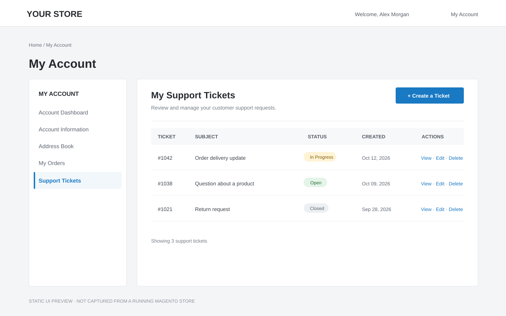
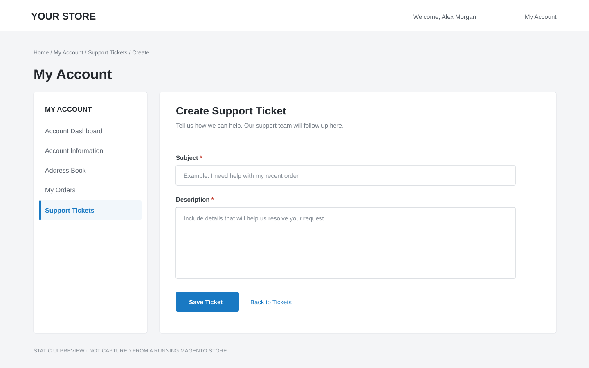
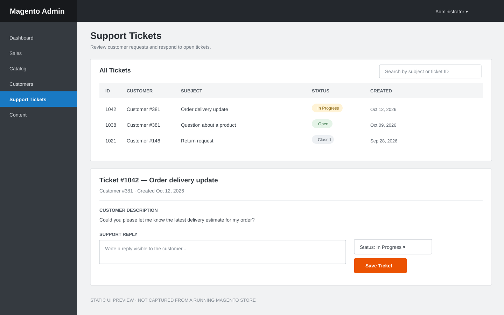

# CustomerSupport_Ticket

Magento 2 module that lets signed-in customers create, view, edit, and delete their own support tickets. Administrators can review tickets, update their status, reply to customers, and delete tickets from the admin panel.

## Screenshots

These are static UI previews to illustrate the customer and admin workflows. They are not screenshots captured from a running Magento installation.

### Customer ticket list



### Create a ticket



### Admin ticket management



## Installation

Copy this module directory to `app/code/CustomerSupport/Ticket` in the Magento installation, then run:

```bash
bin/magento module:enable CustomerSupport_Ticket
bin/magento setup:upgrade
bin/magento cache:flush
```

Customers can manage tickets from **My Account → Support Tickets**. Administrators can open **Content → Support Tickets**; access is controlled by the **Customer Support Tickets** ACL permission.
